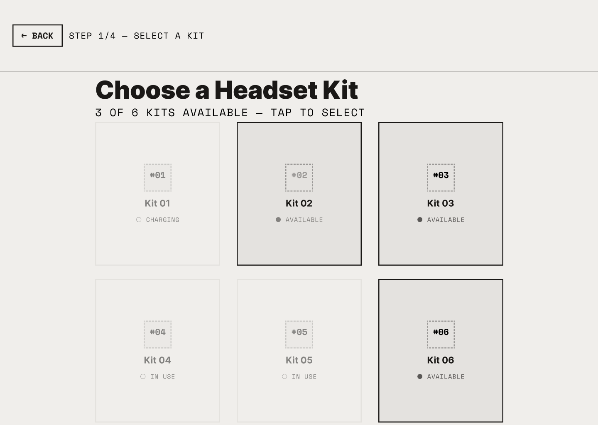
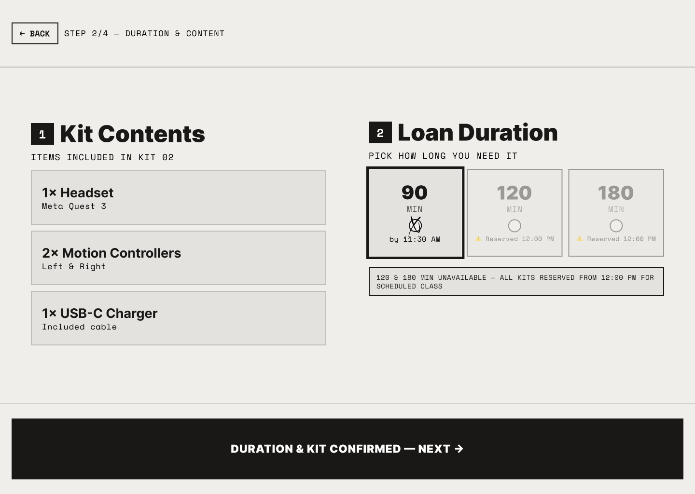
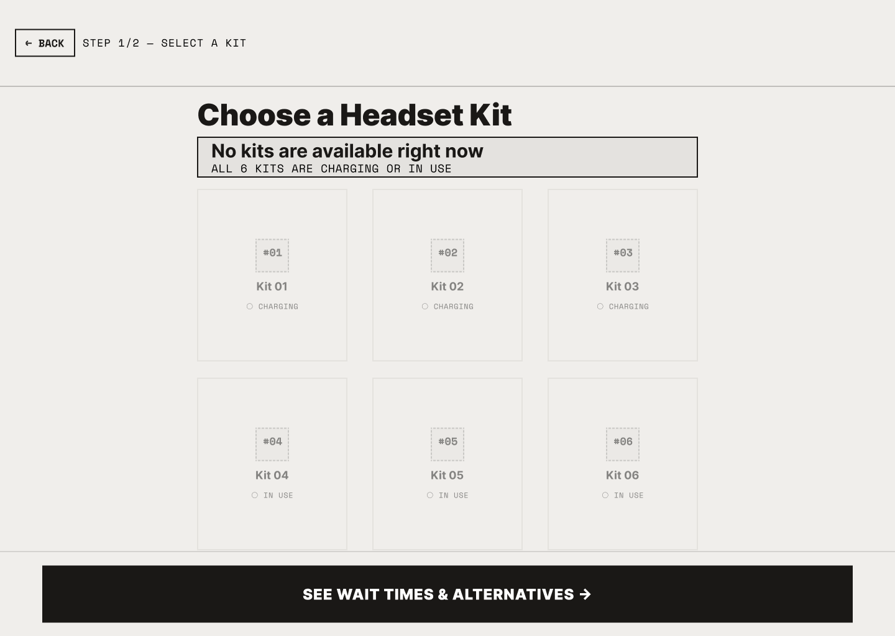
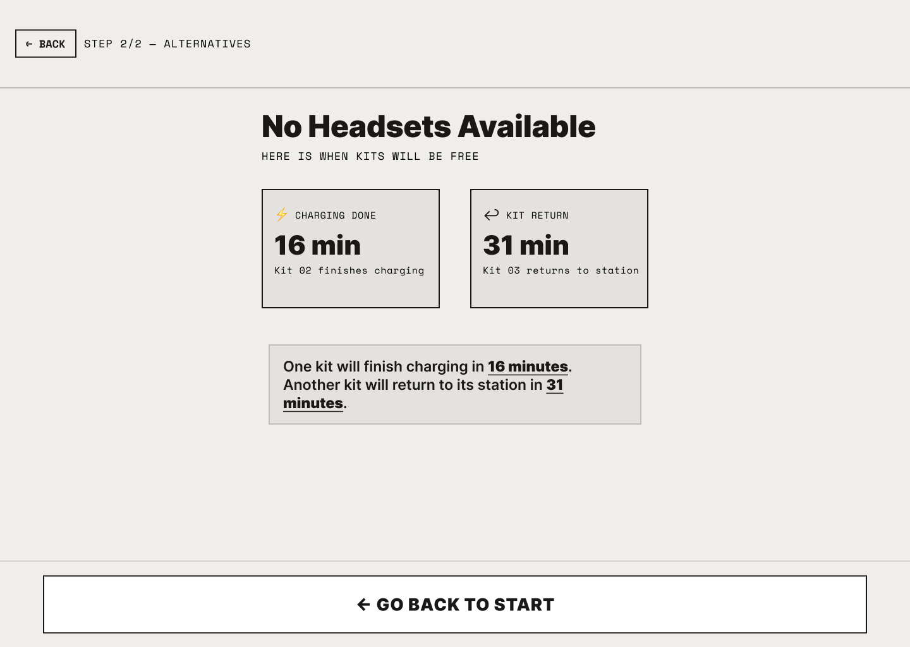

# Design justification

## Decision 1 - Unavailable kits look disabled and say why
- **User problem:** at the kiosk the student does not know which kits can be borrowed. If they tap a kit that is charging or in use and nothing happens, they don't know if the kiosk is broken or what to do next.
- **HCI principle:** visibility of system status and error prevention. Also helping users recognize and recover from errors. Feedback. 
- **How the design solves it:** every kit card shows its state (AVAILABLE, CHARGING, IN USE) and the ones that can't be picked are greyed out. The subtitle says how many kits are available. If the student still taps an unavailable kit, the kiosk does not select it and shows a message with the reason and the time it will be free, so they can pick another one.
- **Image:**

  

## Decision 2 - Check the kit contents before confirming
- **User problem:** students take the kit without checking it and later find a missing controller or charger. Then they could be blamed for it when they return the kit.
- **HCI principle:** error prevention and a constraint: the next step is blocked until the required action is done.
- **How the design solves it:** the duration screen lists the 3 items of the kit and the student taps each one to check it. The Next button stays disabled until all items are checked and a valid duration is picked. Durations that can't be used (120 and 180 min) are shown but blocked.
- **Image:**

  

## Decision 3 - No kits: a real next step instead of a dead end
- **User problem:** when all kits are charging or in use, the student gets stuck. Without more information they will keep coming back or ask the staff.
- **HCI principle:** visibility of system status and user control and freedom. Also help users recover (give a way forward).
- **How the design solves it:** the kit screen explains that all 6 kits are charging or in use. The alternatives screen shows when the next kit will be free, calculated from the saved loans. The student can press "Notify me when a kit is ready", the choice is saved and the kiosk confirms it.
- **Image:**

  
  

## Figma vs Unity
| Figma | Unity | Why it changed |
|---|---|---|
| Kit contents were only a list | Each item has to be tapped to check it before Next works | The project requires verifying the kit contents before confirming. A plain list does not prove the student checked anything. |
| Unavailable kits were greyed out with a note | Same, plus a message with the reason and the time the kit is free when it's tapped | In Figma the tap did nothing. In a working app a tap with no response looks like a bug. |
| One EDIT button on the review screen | Separate Edit kit and Edit duration buttons | Each one goes straight to what the student wants to change and keeps the other valid choices. Changing the kit keeps the duration but asks to check the new kit's items. |
| Alternatives screen only had "Go back to start" | Added "Notify me when a kit is ready" (saved) | The project asks for a working next step in scenario B. Going back to start does not solve the problem. |
| Wait times were fixed (16 min, 31 min) | Calculated from the saved kits | The inventory is real data now, so the times have to match it. |
| Pickup was always Locker #05 | Each kit has its own locker (Kit 02 -> Locker #02) | With six kits, a fixed locker would send students to the wrong place. |
| No reset controls | RESET A and RESET B buttons on the start screen | Needed to test both scenarios and to reset the saved data. They only show on the start screen so a student can't press them by mistake during a checkout. |
| Black deadline bar on the review screen | Deadline shown as a row in the review | Simpler to build with Unity UI and the information is still on screen. |
| Monospace font for small text | Default Unity font | The legacy Unity Text only comes with the default font. |
