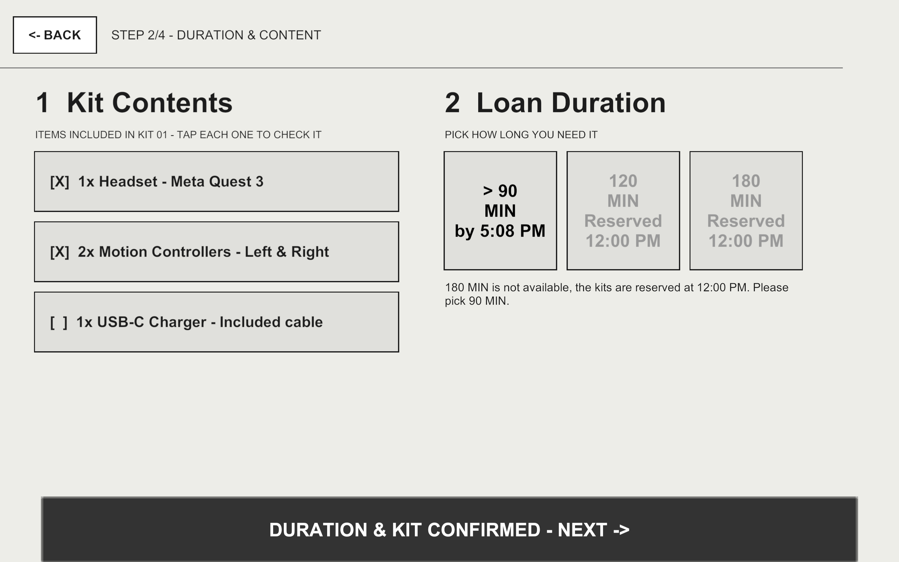
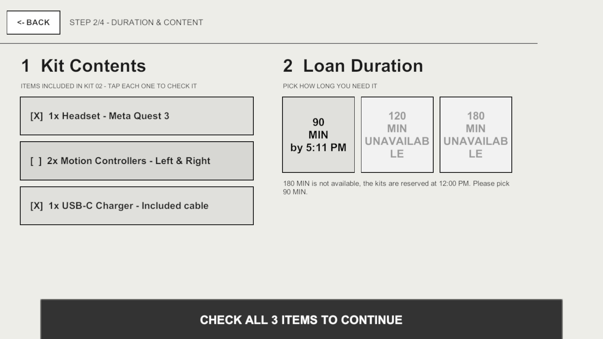

# Testing report

Build tested: v1.0.0 (commit 02158fd). Fixes retested on v1.1.0 (commit 8f8237f).

## Functional cases
| # | Case | Setup | Steps | Expected | Actual | Pass/Fail | Evidence |
|---|---|---|---|---|---|---|---|
| 1 | Checkout | RESET A | Pick Kit 03, check items, 90 MIN, confirm | Locker #03 and deadline shown | As expected | Pass | [evidence1](images/evidence1.png) |
| 2 | No availability | RESET B | See Alternatives, Notify me | Wait time and confirmation shown | As expected | Pass | [evidence2](images/evidence2.png) |
| 3 | Invalid kit | RESET A | Tap a CHARGING or IN USE kit | Not selected, message says when it's free | As expected | Pass | [evidence3](images/evidence3.png) |
| 4 | Editing choices | RESET A | On Review, edit kit and duration | New kit shown, duration kept | As expected | Pass | [evidence4](images/evidence4.png) |
| 5 | Saved data | Loan from case 1 | Close and open the app | Kit still IN USE | As expected | Pass | [evidence5](images/evidence5.png) |
| 6 | Reset | Active loan | Press RESET A or B | Kits go back to that scenario | As expected | Pass | [evidence6](images/evidence6.png) |

## User tests
| Participant | Scenario | Completed | Time | Errors | Help | Observations |
|---|---|---|---|---|---|---|
| P1 | A | Yes | 35s | 1 | None | Tried Next without checking all the items. |
| P1 | B | Yes | 18s | 0 | None | Went to Alternatives and pressed Notify me. |
| P2 | A | Yes | 23s | 0 | None | No problems. |
| P2 | B | Yes | 15s | 0 | None | No problems. |
| P3 | A | Yes | 28s | 1 | None | Tried to pick 120 min, then picked 90. |
| P3 | B | Yes | 16s | 0 | None | No problems. |
| P4 (retest, v1.1.0) | A | Yes | 20s | 0 | None | Read the Next button message and checked the items. |
| P4 (retest, v1.1.0) | B | Yes | 14s | 0 | None | No problems. |

## Fixes
**Fix 1:** P1 pressed Next without checking the items and didn't know why it was disabled. Now the button says what is missing ("CHECK ALL 3 ITEMS TO CONTINUE").

**Fix 2:** P3 tried to pick 120 min because it looked selectable. Now 120 and 180 look disabled and say "UNAVAILABLE".

| Before | After |
|---|---|
|  |  |

**Retest:** P4 did both scenarios on v1.1.0 with no errors and no help.

## Unresolved issues
- "Notify me" doesn't send a real email.
- 120 and 180 min are always blocked (fixed rule).
- No return flow, a kit is free only when its time is over.
- The UNAVAILABLE label is cut on the 120 and 180 buttons.
- Default Unity font instead of the Figma font.
- Only tested on Mac.
